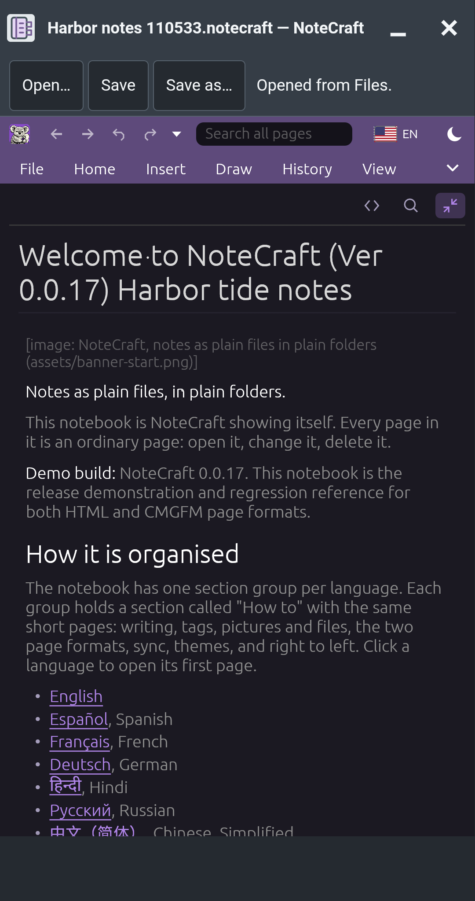

# NoteCraft on the Galaxy S10+

NoteCraft wrapper `4b751a8` in viewer `1899c82ed7a8` uses the retained native Rust/WASM editor. The [WebOS README](../../webos/README.md#build-and-test) documents build inputs and the portable notebook format. The viewer accepts the verified native package through `--notecraft-site`.

1. Open **Apps → Office → NoteCraft** while signed in. Complete first-run setup. For this fixture, use HTML pages and add the provided Welcome notebook.
2. Tap the page title to open the Android keyboard. Type **Harbor tide notes** into the title.
3. Tap **Save** in the WebOS notebook toolbar. Open **Documents**, choose **Use this folder**, and enter a bare notebook name. The filename gains `.notecraft`.
4. Close NoteCraft. Open the file from **Files → Documents** and confirm the editable title. The stored ZIP contains the title in the page HTML.

The physical S10+ used Chrome 158.0.8127.92 at 411 CSS pixels and 480 CSS pixels high with the keyboard. The dark file toolbar stayed readable. The prior wrapper showed a failure banner over the responsive welcome wizard when Chrome deferred a resize notification. The updated wrapper showed **New notebook** and **Opened from Files** appropriately. Both archive tests passed.

The phone passed three of nine reviewed workflows. It chose the HTML starter notebook, edited a title with the Android keyboard, and saved and reopened the portable archive. Chromium at 820 and 1300 CSS pixels opened the archive and saved copies with bare filenames. It also verified that the browser resize notice leaves the file status intact and an error event with an actual error object still reaches the banner. The exact archive retained the edited HTML title in all three saved downloads.

Freshly opened blank notebooks still show first-run setup. The saved notebook opened directly. The remaining workflow groups cover body text and Markdown, attachment rendering, subsequent save, conflict recovery, external import, and native output. A desktop window tiled beside Files also leaves limited reading width. On box-webhost, `/var/backups/webos-notecraft-resize-status-1899c82ed7a8/deploy-viewer.py rollback` restores the preceding viewer.

